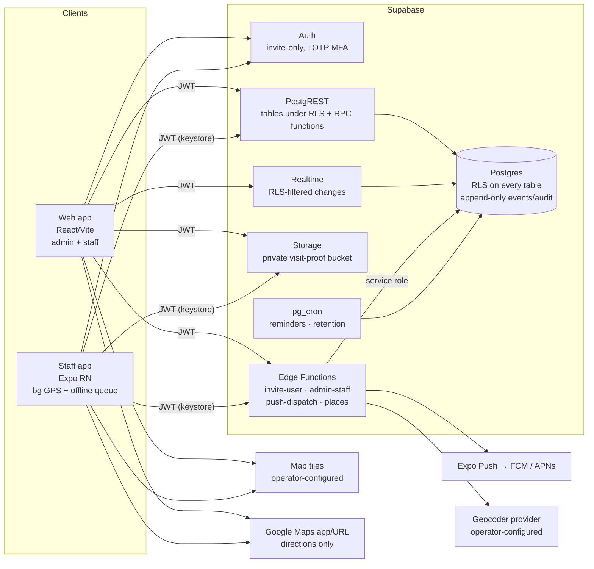
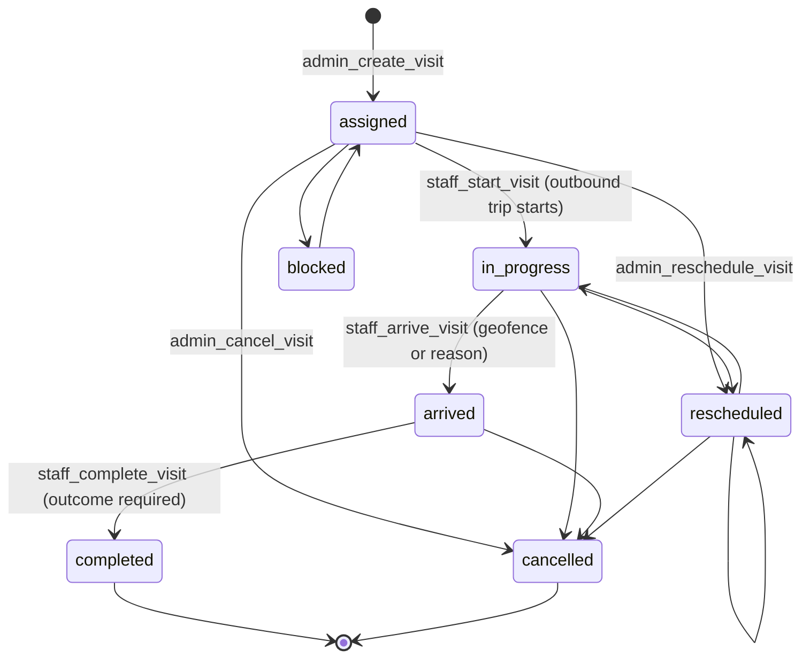

# Architecture

## Why business logic lives in Postgres functions

Status transitions, location ingestion, purchases and reports are `SECURITY DEFINER` SQL functions exposed
as PostgREST RPC. Each derives the caller, role and organization from the verified JWT (`auth.uid()`), validates
input, writes the state change **and** its append-only event (and notification outbox row) in one transaction.
This gives server- and database-enforced authorization with no always-on server, and lets CI test the real
logic on PGlite. Edge Functions exist only where a service-role credential or third-party call is required
(Auth admin API, Expo push, geocoding).

## Visit state machine

Return leg (`staff_start_return` → `staff_end_trip`) happens after `completed` and is reported separately.
Reassignment keeps the status at `assigned`, abandons any active trip and moves access to the new staff member.

## Location data flow

1. Staff taps **Start duty** → permission education → OS permission → `start_duty('tracking'|'limited')`.
2. Background task (`expo-location` + foreground service on Android) writes fixes to the local SQLite queue
   (configurable interval/distance from Settings).
3. `sync.flush()` uploads ≤200 points per call to `ingest_location_batch` with `client_event_id` + `sequence`.
   The server validates ranges, flags `low_accuracy` / `teleport` (>70 m/s) / `clock_drift` / `stale`, de-duplicates,
   stores raw points in `location_points`, and updates one `latest_staff_position` row (never with an older fix).
4. Admin map subscribes to Realtime only while open; RLS restricts rows to the admin's organization.
5. **End duty** stops the task; the server refuses points outside an active tracking duty.

Route display draws polylines only between consecutive accepted points of the same trip and splits at gaps
> 5 minutes. Planned directions are never drawn — they open in Google Maps.

## Offline

Mobile actions (start/arrive/complete/return/end/duty) carry an idempotency key and are tried immediately; on
network failure they are queued and replayed **in order** with exponential backoff. Server rejections during
replay are kept and shown to the staff member ("Couldn't sync …"). Admin data only changes after server
acknowledgement. Visit details and lists are cached for offline viewing and cleared on logout.

## Data model

See `supabase/migrations/20261120000100_schema.sql`. Core tables: organizations, profiles, invitations, products,
farmers, purchases, purchase_items (immutable price snapshots), visits (+version for optimistic concurrency),
visit_events (append-only), visit_outcomes, duty_sessions, trips, location_points, latest_staff_position,
user_notifications, notification_outbox, device_tokens, attachments, audit_log (append-only), session_events,
geocode_cache, rate_limits.
